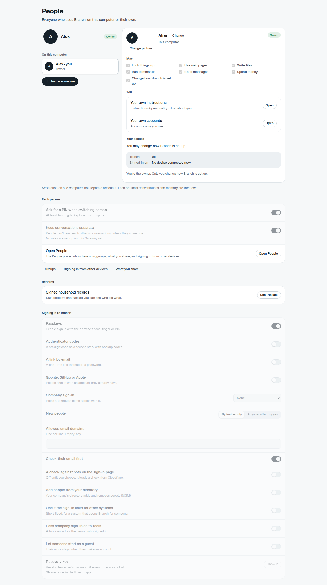
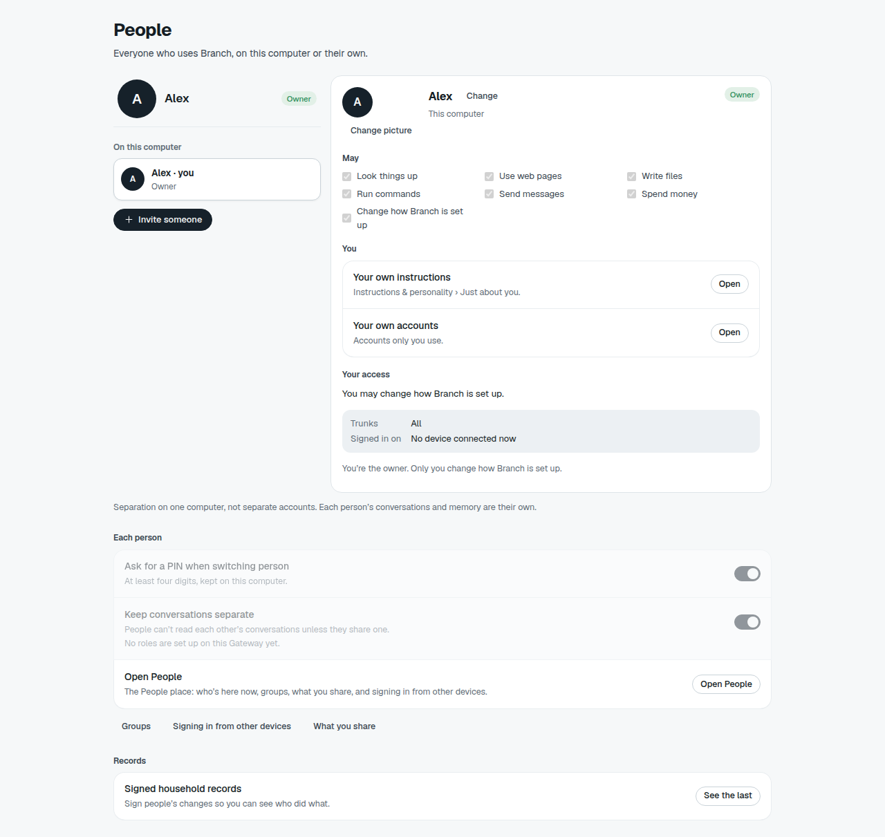
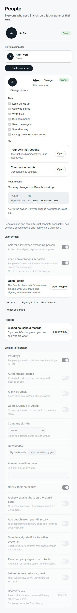
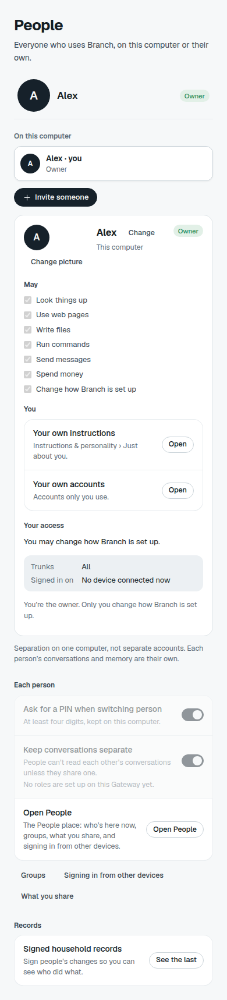

# NA-07: unsupported People sign-in rows

Before: main at `10e21d05d`. After: the NA-07 source changes in this pull request.

The captures render the real `PeoplePage`, `KitProvider` at Advanced level and
production theme, shell, frame, control, Settings kit and People styles through
an isolated Vite preview. They use a synthetic owner named Alex, no devices,
no roles and an empty audit response. No running app data or credentials were used.
The harness expands its scrolling container for full-page screenshots.

| Width | Before | After |
| --- | --- | --- |
| 1280 px |  |  |
| 390 px |  |  |

Browser checks at both widths confirm the sign-in section exists before and is
absent after, with no page errors. After the change, `See the last` opens the
empty audit dialog and `Invite someone` opens the own-device tab with the
one-time-code action available. Neither width overflows horizontally.
These are fixture-backed component checks, not a connected gateway or released
app verification. The installed build must be checked after independent merge
and release. Unrelated disabled controls are unchanged by this focused fix.
